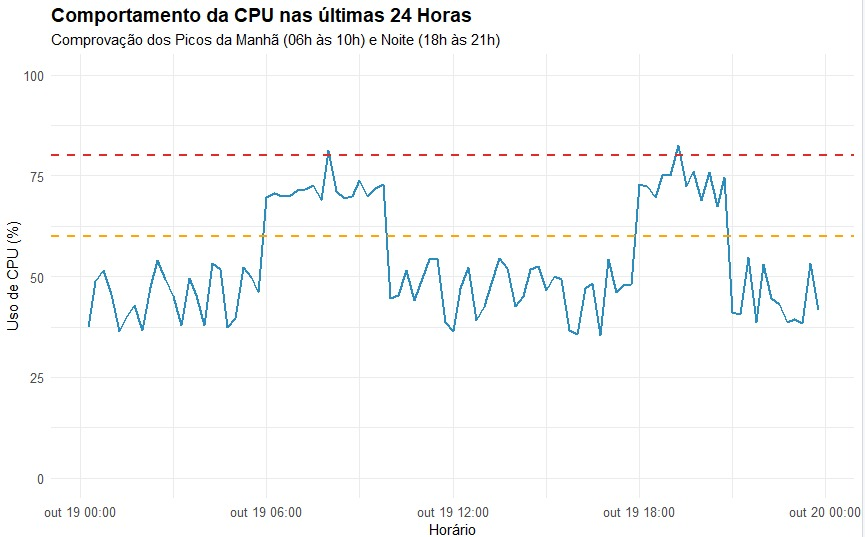
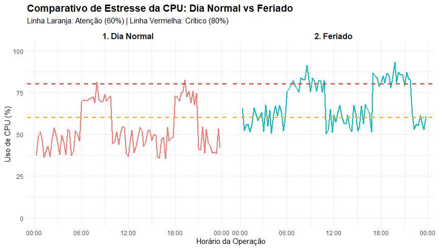

# Montech-R ✈️✈️
# Validação de Dashboard AWS

Este repositório contém um script em R desenvolvido para analisar e validar os dados brutos de telemetria de servidores hospedados na AWS. O objetivo principal do projeto é comprovar matematicamente e visualmente que o dashboard calcula e exibe corretamente indicadores de carga, desempenho e limites de operação sob diferentes condições de utilização.


## Tecnologias Utilizadas

O projeto foi desenvolvido inteiramente em **R**, utilizando pacotes modernos para manipulação de dados e geração de gráficos:
*   `dplyr`: Para manipulação de dados, agrupamentos, filtros e sumarizações de forma limpa e otimizada.
*   `ggplot2`: Para a criação de visualizações de dados profissionais e customizáveis.
*   `lubridate`: Para o tratamento e conversão eficiente de datas e séries temporais (`TimeStamp`).
*   `readr`: Para a importação rápida e segura de arquivos CSV.

## Resultados e Visualizações

Os principais entregáveis do script são as visualizações gráficas que comprovam o comportamento da infraestrutura sob diferentes níveis de estresse.

### 1. Comportamento Diário e Picos de Operação
O primeiro gráfico ilustra o uso de CPU do servidor ao longo de 24 horas. É possível observar claramente dois momentos de pico de tráfego que ultrapassam a linha de **Atenção (laranja tracejada em 60%)**
*   **Pico da Manhã (06h às 10h):** Impulsionado pelo início da malha diária.
*   **Pico da Noite (18h às 21h):** Marcado pelo retorno de viagens e encerramento do dia comercial.



### 2. Impacto Sazonal: Dia Normal vs Feriado
Para analisar a capacidade de resiliência da arquitetura, o script gera um comparativo lado a lado entre um dia normal de operação e um feriado. 

A visualização comprova que, durante o feriado, a carga basal do servidor é significativamente mais alta. Os picos de processamento não apenas ultrapassam a linha de atenção com mais frequência, como também atingem e rompem repetidamente a **linha Crítica (vermelha tracejada em 80%)**, demonstrando o estresse severo da máquina.



## Como executar o projeto

**Pré-requisitos:**
*   R e RStudio instalados.
*   Pacotes necessários instalados. Caso não os tenha, execute no console do R: 
    ```R
    install.packages(c("dplyr", "ggplot2", "lubridate", "readr"))
    ```

**Passo a passo:**
1. Clone este repositório para a sua máquina local.
2. Certifique-se de que os arquivos de dados brutos CSV (ex: dia normal e feriado) estão na mesma pasta/diretório em que o RStudio está operando e que as imagens `img.jpeg` e `img2.jpeg` estão na raiz do projeto.
3. Abra o script `.R` no RStudio.
4. Selecione todo o código e clique em **Run** (ou pressione `Ctrl + Enter`).
5. Os resultados das sumarizações estatísticas aparecerão no console e os gráficos comprobatórios serão gerados na aba **Plots** do RStudio.
